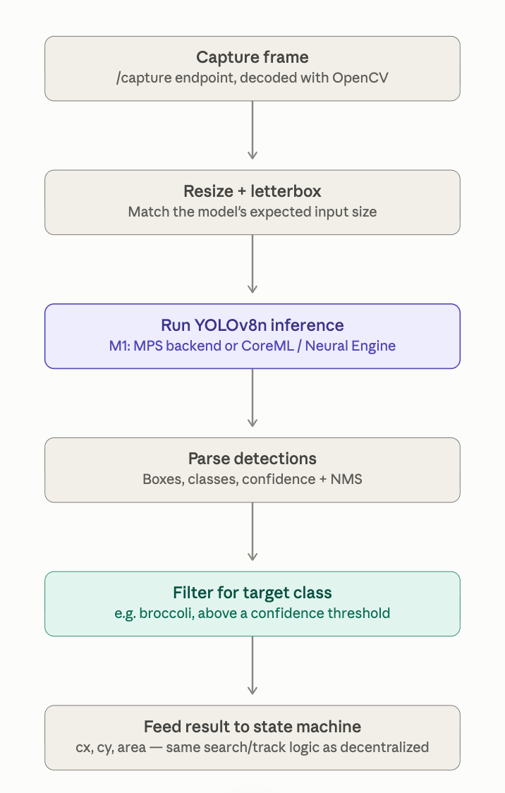
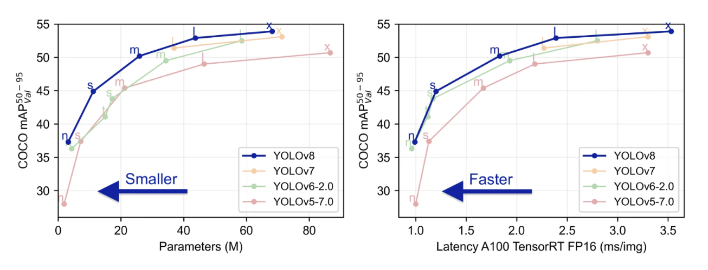
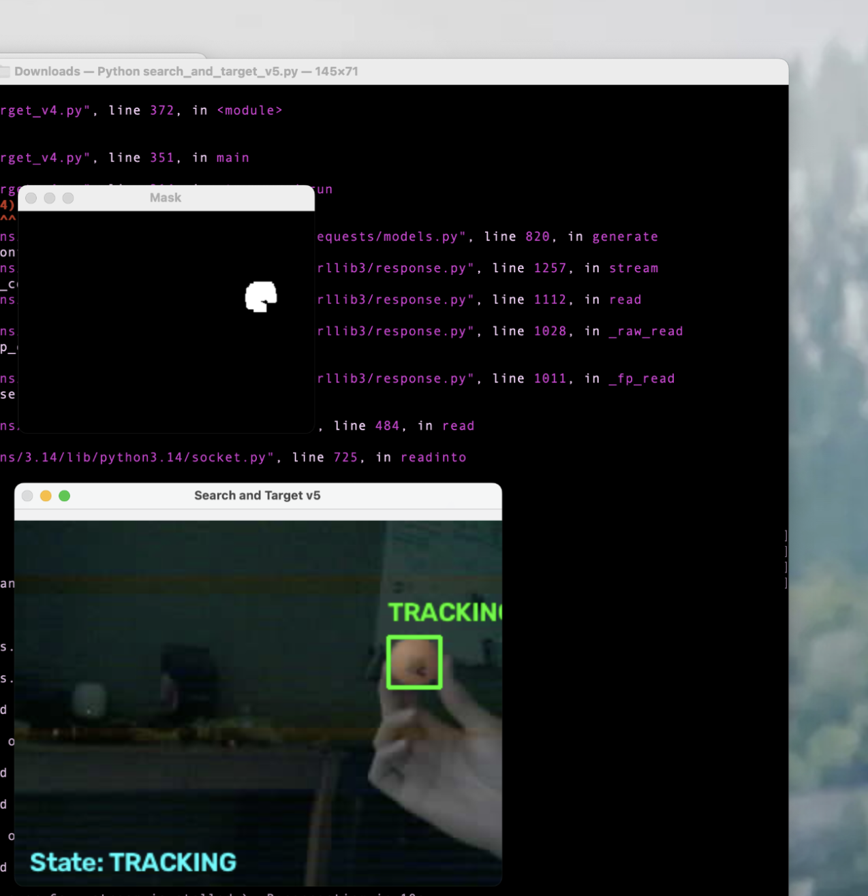
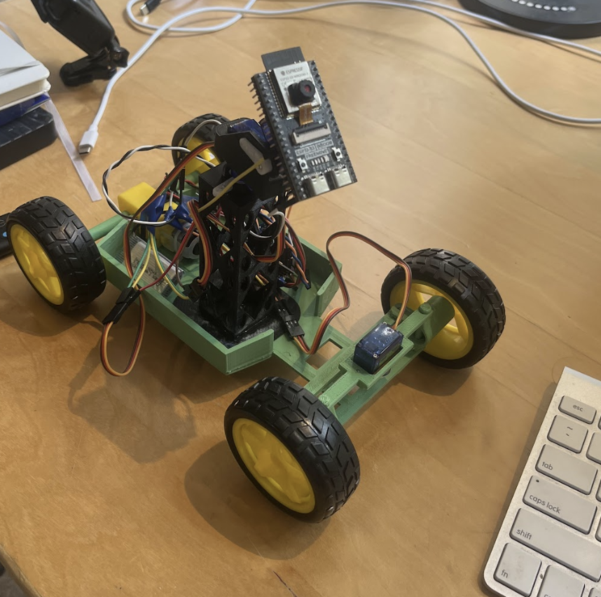
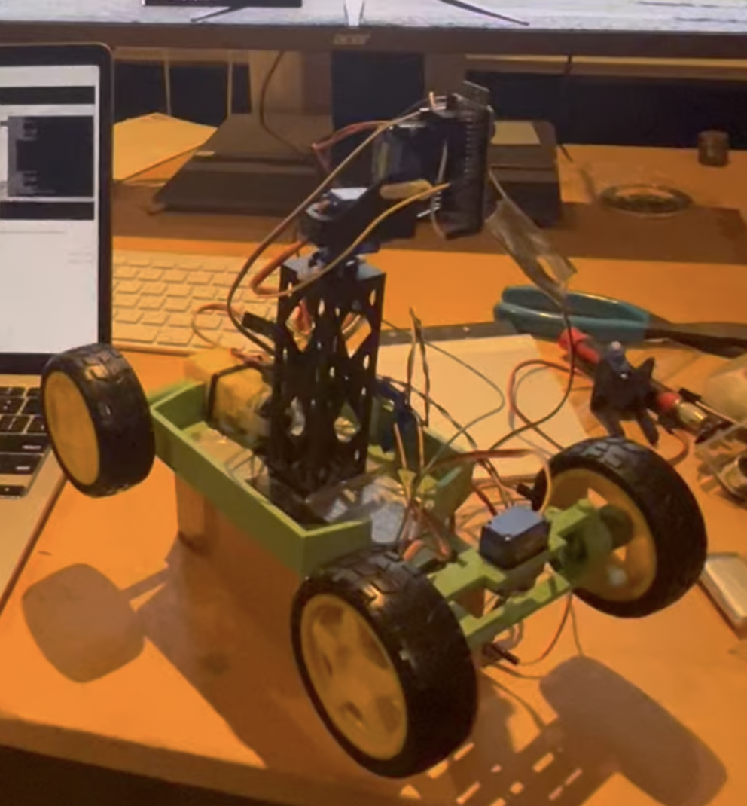
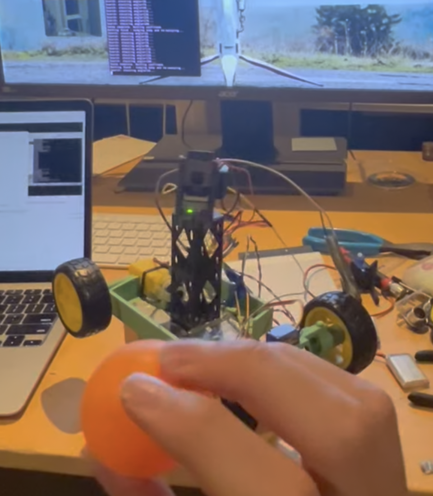
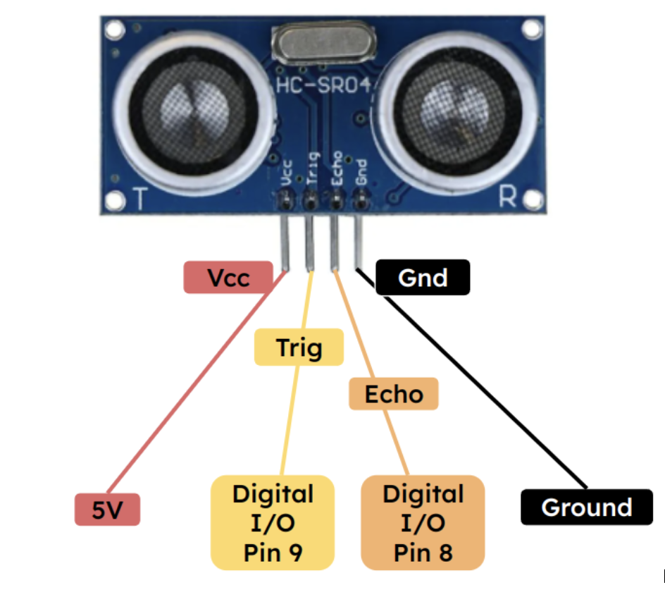
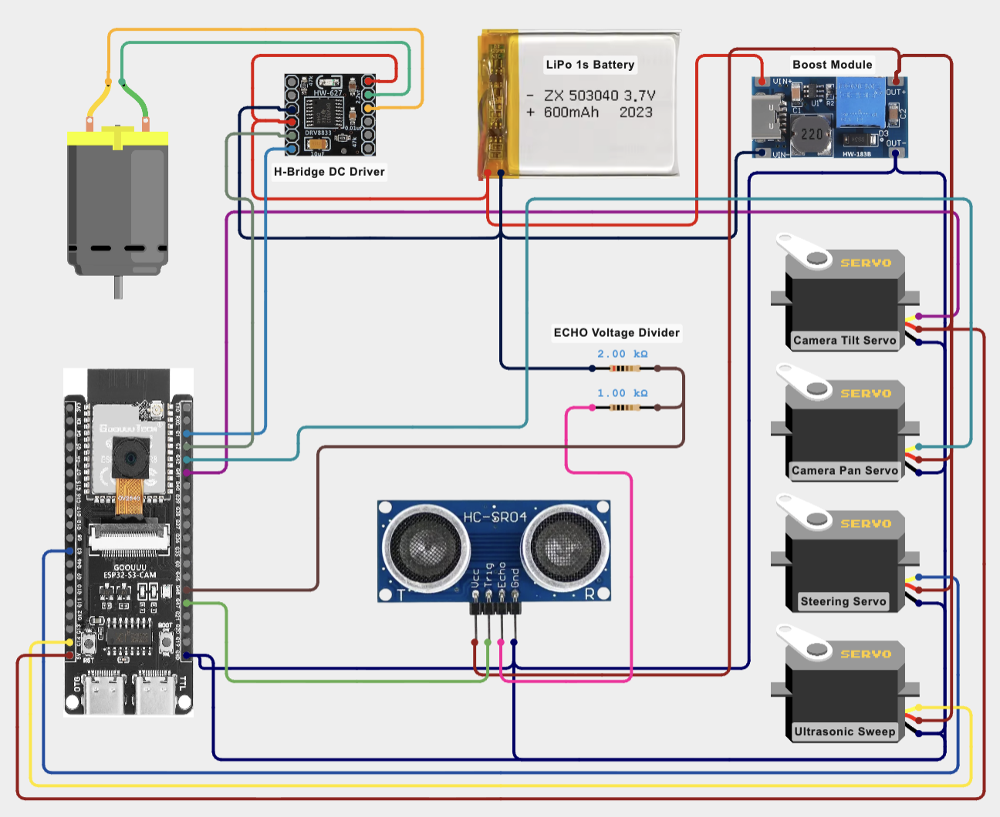
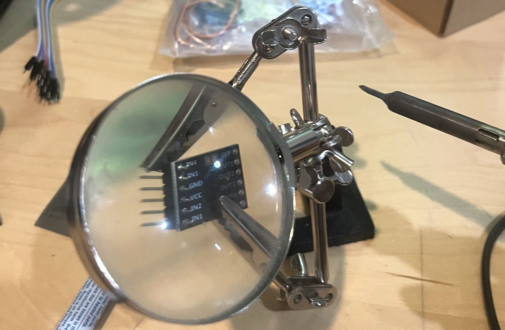

Swarm of low-cost rovers, each about the size of a book, collectively able to search and track a target. Two operating modes:

<!--more-->

## Description

### Centralized

All drones are sending partial video streams back to my computer over a 2.4 GHz local network. My computer runs an Ultralytics YOLOv8 vision model that interprets each rover's video stream. For testing I picked broccoli from the COCO dataset, eliminating difficulties that come with model training. YOLOv8 is a single-pass detector: one forward pass through the network gives you every object it finds in the frame, each with a class label, a confidence score, and a bounding box. Compared to older two-stage detectors that are much slower. The nano variant is the smallest YOLOv8, designed to run on modest hardware rather than a GPU server, which makes sense for my M1 Mac. Check out the pipeline image and how this v8 model stacks up.

  
  

I also run an HSV + Contour vision algorithm. I found this super helpful for testing and worked way better than I was expecting—I'm going to integrate my code as a sort of backup if I run into compute-power limits. I will share my code for this on github—I spent days refining it. It's also helpful to communicate HSV values to other rovers via ESP-NOW (see below) once the target is located.

*Here shown with the lights off. Search was successful so it's actively tracking.*

Here are two clips of that:

  

    <video controls preload="metadata" style="width: 100%;">
      <source src="TestTrackingHSV2.mov">
      Your browser does not support this video.
    </video>
    
<em>Here's a video of that. You can see in my terminal that the search identified two candidates in its sweep (at 56 degrees and 76 degrees) and selected the more promising one to track.</em>

  

  

    <video controls preload="metadata" style="width: 100%;">
      <source src="TestTrackingPingPong2.mov">
      Your browser does not support this video.
    </video>
    
<em>Here is an external view. It starts in the tracking mode (you can see the car trying to drive towards the ball) but immediately after I remove the ball, it initiates the search mode, panning, trying to identify target candidates.</em>

  

### Decentralized

I wanted the swarm to work in "comms-denied" environments as well. This is a primary reason I chose the ESP32 S3; ESP-NOW is a connectionless, low-power protocol Espressif built into ESP32's WiFi module. It doesn't go through a router, doesn't require DHCP or an IP address, and doesn't need an association handshake before sending. Each device registers the other's MAC address as a peer and fires small packets directly. How cool is that.. By using dead reckoning, the rovers' starting positions with respect to each other, and the ultrasonic sensor addition (process described below), a partial map is created and paths are stored. This is effectively the grid system used in NATO operations; the Military Grid Reference System (MGRS) translates global locations into easily communicated alphanumeric codes. Here, once the target is located, available units can dispatch themselves to its location via ESP-NOW. This is where communicating HSV values helps too for reliably identifying the same target.

## Design

My goal was to pack as much functionality into each rover while keeping costs down. I was pretty successful: each rover costs less than $28 dollars including filament and the battery. The majority of this cost is obviously the ESP32. Check out the component schematics and the price breakdown below.

In terms of programming:

- **C++**: The firmware running on the ESP32-S3 itself, including camera capture, WiFi/HTTP endpoints, motor/servo control, and proportional-steering.
- **Python**: the control scripts running on my mac, including image processing with OpenCV, the search/track/approach state system, and HTTP requests to the car.
- **OpenCV (cv2)**: HSV color thresholding, contour/blob detection, and overlays.
- **Requests**: Python's HTTP client.
- **HTML/CSS/JS**: the car's control webpage, served straight from the firmware's IP, that I used to calibrate servos and test functionality.

The prototype was a simple chassis with a central tower that houses the sensors. See photos:

  
  
  

This kept things simple for what felt like endless debugging… To be clear I had very little vision model experience before this project but I found that it's a super cool application. I designed the tower to be modular. Each set of two ovals act as a mounting point for additional components. I was super happy I built this in early on because I did end up adding subcomponents (see next section). Although it hasn't caused any problems it probably deserves a redesign for elegance… it must have been really late when I designed this 😂.



*Drag to rotate, scroll to zoom.*

**[⬇ Download tower.stl](tower.stl)**

I utilized the modular design of the central tower when adding the ultrasonic sensor. There is a clear design issue with adding an additional sensor anywhere but the tower: blocking part of the camera's FOV. I decided to use the most basic HC-SR04 that I had laying around because it operates at 5V (like the servos and motor controller) and can operate at 4 meters (plenty). The goal: ultrasonic sensor panning concurrently but independently from ESP32 camera operation. Below is the part I designed: the oval ends slot into the tower, the body supports itself on the tower's side, and the servo locks into place upside down. Next, the servo-sensor connection is straightforward.



*Drag to rotate, scroll to zoom.*

**[⬇ Download ultrasonicmount.stl](ultrasonicmount.stl)**

How the sensor works is straightforward: The trigger pin receives a short 10 µs pulse → the module sends out eight 40 kHz ultrasonic sound bursts → the sound waves bounce off an obstacle and return to the receiver → the echo pin goes high, and the length of the pulse measures the total travel time → distance is calculated using:

**Distance = (Time × Speed of Sound) ÷ 2**

I created a wiring diagram for y'all.

I had some fun soldering as well:

## Next Steps

I am building a couple more of these to build out the fleet. Here are some changes I'm keeping in mind:

- Building out mapping capabilities by improving dead reckoning software.
- Smaller form-factor. The whole rover can be narrower and shorter. I am keeping the wheels the same because the cheap motor I'm using needs everything it can get to make it over obstacles. I am moving the chassis above the axles to get more clearance; I was worried about CG but it does not seem to be a problem.
- Adding a small drone fitted with the same ESP32 S3-CAM communication. The plan is to have them be autonomously deployed off the back of the rovers when deemed necessary (if the rover is unable to reach a portion of the search area… think stairs). I am working on PCB design to design my own flight controller… That project will be posted here too.
- I will separate the ESP32 from the pan / sweep module. This will lighten the load on respective servos and the ESP32 antenna won't be moving constantly which will help connectivity. It will take some creativity to make the camera ribbon cable complacent but I have an elegant solution.
